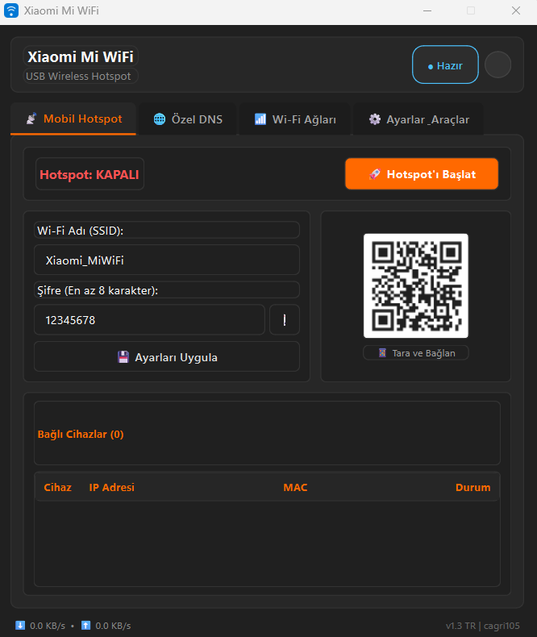
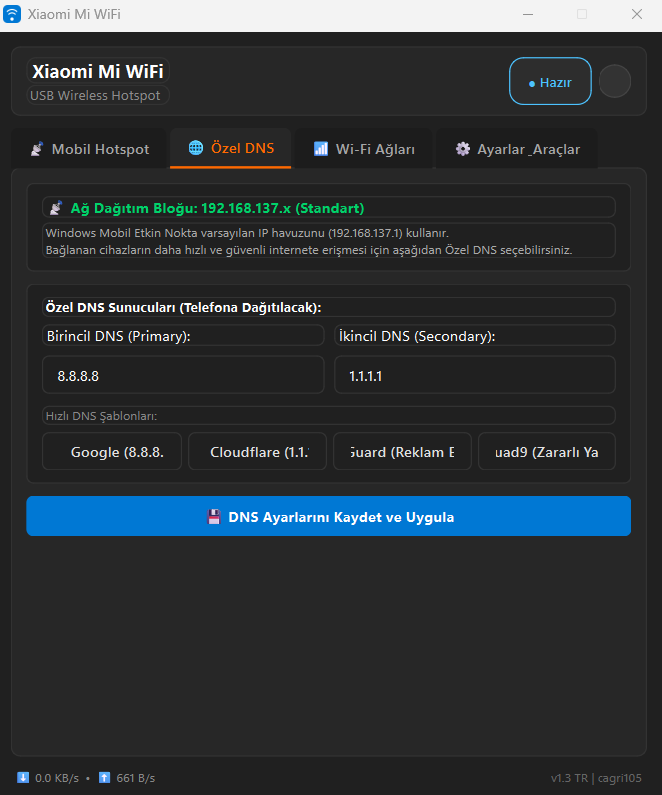
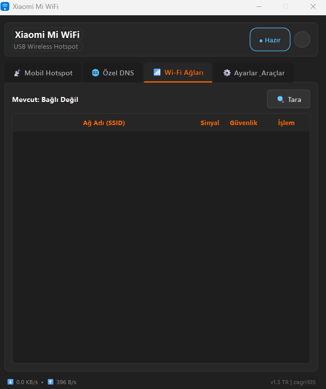
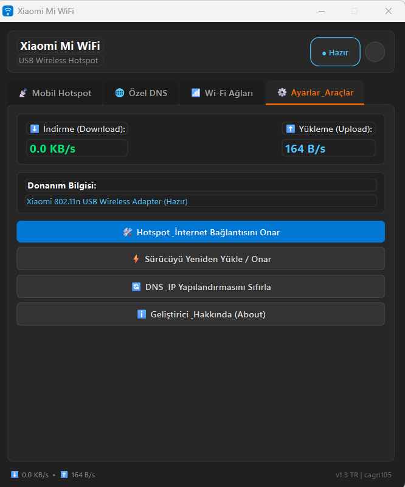

# 📡 Xiaomi Mi WiFi Portable USB Wireless Adapter Hotspot Tool

[-blue.svg)](https://github.com/)
[](https://www.python.org/)
[](https://pypi.org/project/PyQt6/)
[](LICENSE)

**Xiaomi Portable Mi WiFi (Mini USB Dongle)** adaptörünü Windows 10 ve Windows 11 üzerinde tak-çalıştır hızında mobil erişim noktası (Hotspot) veya Wi-Fi alıcısı olarak çalıştırmayı sağlayan Türkçe, modern ve gelişmiş yönetim yazılımıdır.

<p align="center">
  
</p>

---

## ✨ Özellikler

- **🔌 Otomatik Sürücü Algılama ve Kurulumu:** Cihaz takıldığında donanım kimliğini (`VID_2717&PID_4106`) otomatik algılar, sürücü eksikse gömülü MediaTek/Xiaomi sürücülerini tek tıkla Windows'a yükler.
- **📶 Mobil Hotspot (Erişim Noktası):** Windows Wi-Fi Direct API ile kararlı ve hızlı kablosuz ağ oluşturma.
- **👥 Canlı Bağlı Cihazlar Listesi:** Hotspot'a bağlanan cihazların adlarını, IP ve MAC adreslerini anlık olarak listeleme.
- **🌐 Özel DNS & Güvenlik Profilleri:**
  - ⚡ **Google DNS** (`8.8.8.8` / `8.8.4.4`)
  - 🛡️ **Cloudflare DNS** (`1.1.1.1` / `1.0.0.1`)
  - 🚫 **AdGuard DNS** (`94.140.14.14` / `94.140.15.15`) — Bağlı cihazlar için reklam ve izleyici engelleme
  - 🔒 **Quad9 DNS** (`9.9.9.9` / `149.112.112.112`) — Zararlı yazılım ve oltalama koruması
- **🛠️ Ağ & İnternet Onarım Aracı:** Windows Güvenlik Duvarı kurallarını, ICS servislerini (`SharedAccess` / `icssvc`) ve IP Yönlendirmeyi (IP Routing) otomatik onarma.
- **📊 Canlı Ağ Trafiği İzleme:** Anlık indirme (Download) ve yükleme (Upload) hız göstergeleri.
- **🖥️ Sistem Tepsisi (System Tray) Entegrasyonu:** Arka planda sessiz çalışma, hızlı başlat/durdur menüsü.

---

## 📸 Ekran Görüntüleri (Screenshots)

<table align="center">
  <tr>
    <td align="center" width="50%">
      <b>📡 Mobil Hotspot & Bağlı Cihazlar</b><br>
      
    </td>
    <td align="center" width="50%">
      <b>🌐 Özel DNS & Güvenlik Profilleri</b><br>
      
    </td>
  </tr>
  <tr>
    <td align="center" width="50%">
      <b>📶 Wi-Fi Ağları</b><br>
      
    </td>
    <td align="center" width="50%">
      <b>⚙️ Ayarlar, Trafik & Ağ Onarımı</b><br>
      
    </td>
  </tr>
</table>

---

## 🚀 Hızlı Başlangıç (Hazır EXE)

1. [Releases](../../releases) bölümünden en güncel **`Xiaomi_MiWiFi_Turkce.exe`** dosyasını indirin.
2. Xiaomi USB Wi-Fi dongle'ınızı bilgisayarın bir USB portuna takın.
3. Programı **Yönetici Olarak** çalıştırın.
4. Ağ adı (SSID) ve şifrenizi belirleyin, ardından **"Hotspot'ı Başlat"** butonuna tıklayın.

---

## 💻 Kaynak Koddan Çalıştırma ve Derleme

### Gereksinimler
- Python 3.10 veya üzeri
- Windows 10 / 11 (64-bit)

### Kurulum

1. Depoyu klonlayın:
```bash
git clone https://github.com/kullaniciadi/xiaomi-mi-wifi-hotspot.git
cd xiaomi-mi-wifi-hotspot
```

2. Gerekli Python paketlerini yükleyin:
```bash
pip install PyQt6 psutil pywin32 dnspython
```

3. Uygulamayı başlatın:
```bash
python app_main.py
```

### Tek Dosya EXE Derleme (PyInstaller)

Projede bulunan derleme betiğini çalıştırabilirsiniz:
```cmd
exe_olustur.bat
```
veya doğrudan komut satırından:
```bash
pyinstaller Xiaomi_MiWiFi_Turkce.spec
```
Derlenen `.exe` dosyası `dist/` klasöründe oluşacaktır.

---

## 📁 Proje Mimarisi

```text
├── app_main.py                 # Modern PyQt6 Arayüzü ve Sistem Tepsisi Yönetimi
├── wifi_service.py             # Wi-Fi Direct Hotspot, Sürücü, DNS Proxy ve ICS Mantığı
├── drivers/                    # Xiaomi 802.11n USB Wi-Fi Sürücü Paketleri (INF/SYS)
├── embedded_drivers/           # Otomatik kurulum için gömülü sürücü veritabanı
├── exe_olustur.bat             # Tek tıkla PyInstaller derleme scripti
├── Xiaomi_MiWiFi_Turkce.spec   # PyInstaller spec dosyası
└── README.md                   # Proje dokümantasyonu
```

---

## 👤 Geliştirici & İletişim

- **Geliştirici:** cagri105
- **E-posta:** [cagrii@gmail.com](mailto:cagrii@gmail.com)
- **Sorun Bildirimi:** [GitHub Issues](../../issues)

---

## 📄 Lisans

Bu proje [MIT Lisansı](LICENSE) altında sunulmaktadır.
